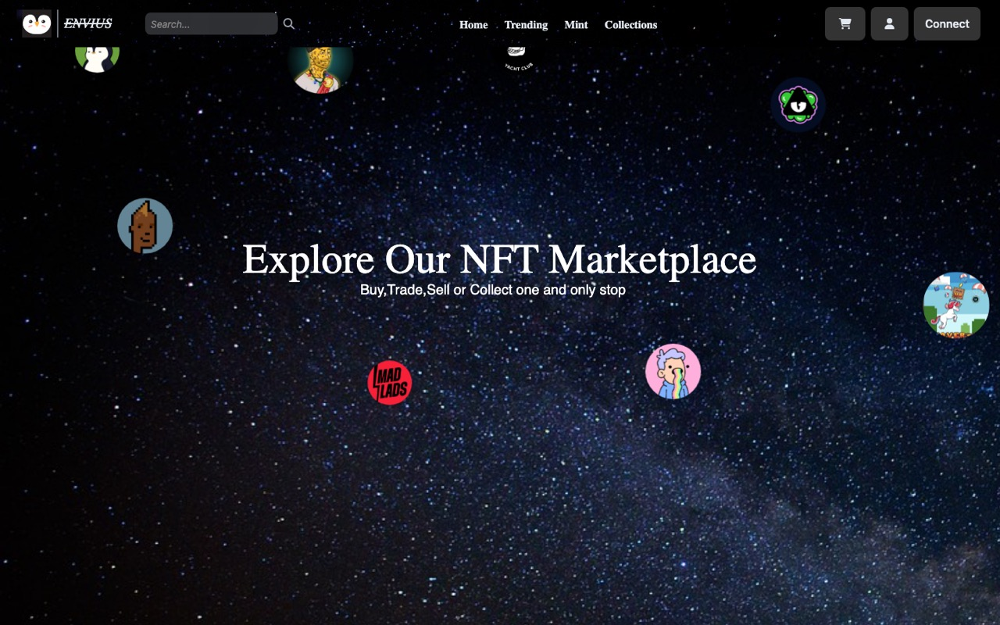

# Envius: NFT Marketplace

A multi-chain NFT marketplace front end: browse trending collections with live OpenSea data, explore collection pages, preview mints and connect a wallet.

**Live demo:** https://nft-marketplace-5i43.vercel.app



## Features

- **Wallet connect** with ethers.js (MetaMask and other injected wallets).
- **Trending** page that pulls collections, images and trading volume from the OpenSea API.
- **Collections** page with collection stats and scroll-driven GSAP animations.
- **Mint** page with chain selection (Ethereum, Base, Optimism, Arbitrum, Linea), mint count and time-window filters.
- Animated home page with floating collection avatars over a parallax star field.

## Tech stack

React 18 · Vite · React Router · Tailwind CSS · ethers.js · GSAP (ScrollTrigger) · react-select · Hardhat (mint script in `test/`)

## Run locally

```bash
cd nft_marketplace
npm install
# create .env with your OpenSea API key
echo "VITE_API_KEY=your_opensea_api_key" > .env
npm run dev
```

## Project structure

```
nft_marketplace/
  src/components/   Home, Trending, Collections, Mint, Connect, Header, Footer
  src/main.jsx      routes: /, /trending, /mint, /collections
  public/           chain logos and collection artwork
  test/mint.js      Hardhat mint script
```

## Author

Built by [Akshat Bhriguvanshi](https://akshatttt321.github.io).
